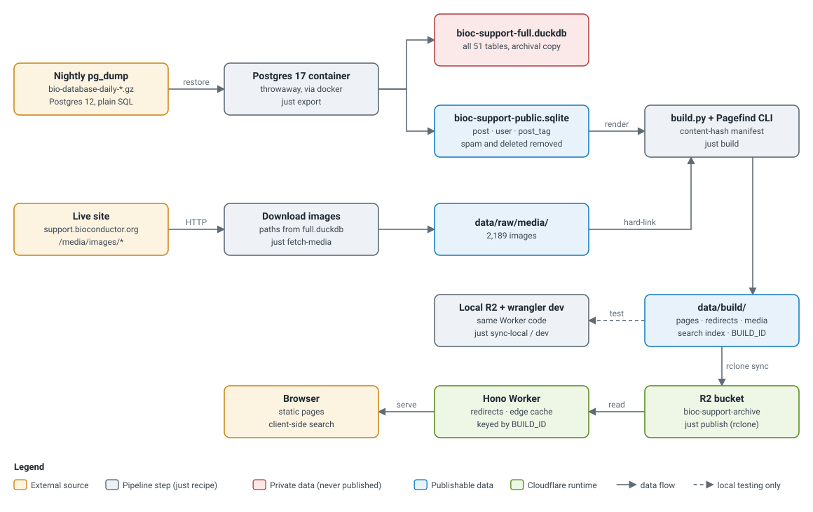

# bioc-support-archive

[](LICENSE)
[](https://bioc-support-archive.seandavi.workers.dev)

A static, read-only archive of [support.bioconductor.org](https://support.bioconductor.org), the
Bioconductor community's question-and-answer site from 2001 to 2026.

The site is being decommissioned. This project keeps its content readable at the same URLs, with
as little infrastructure as possible: no database and no application server, just pre-rendered HTML
in an R2 bucket and a small Cloudflare Worker that serves it.

**Demo:** <https://bioc-support-archive.seandavi.workers.dev>. It is not yet on the
`support.bioconductor.org` domain.

| | |
|---|---|
| Threads | 47,277 |
| Posts (questions, answers, comments) | 159,484 |
| Contributors shown | 20,488 |
| Uploaded images | 2,189 |
| Date range | 2001-11-26 to 2026-10-21 |
| Published files | 98,525 (885 MB) |

*Counts from the 2026-10-22 dump, after spam and deleted posts were removed ([ADR 3](docs/adr/0003-public-subset.md)).*

## How it works



*Each box is a file, a pipeline step or a runtime component, colored by kind (see the legend in the figure).
Solid arrows are the production path. The dashed arrow is local testing only.*

1. **Export** (`just export`): the nightly `pg_dump` is restored into a throwaway Postgres 17
   container. DuckDB then copies every table into `bioc-support-full.duckdb`, a private archival
   copy, and writes the publishable subset to `bioc-support-public.sqlite`. That subset excludes
   emails, password hashes, sessions, tokens, private messages, spam and deleted posts.
2. **Media** (`just fetch-media`): uploaded images are not in the database. Every
   `/media/images/...` path referenced by any post is downloaded from the live site.
3. **Build** (`just build`): `pipeline/build.py` renders one HTML page per thread at `/p/<uid>/`,
   plus the home, search and 404 pages and a `redirects.json` that maps answer and comment IDs to
   their thread. It hard-links the images into place, and the
   [Pagefind](https://pagefind.app) CLI builds a static search index. Builds are incremental: a
   content-hash manifest means only changed pages are rewritten, and the search index is rebuilt
   only when a page changed. A full build takes about 90 s. A build with no changes takes about 8 s.
4. **Publish** (`just publish`): `rclone sync --checksum` uploads only changed files to R2, then
   `wrangler deploy` ships the Worker with the new `BUILD_ID`.
5. **Serve**: a [Hono](https://hono.dev) Worker maps URLs to R2 keys and redirects
   `/p/<answer>/` to `/p/<thread>/#<answer>`, as the old site did. It caches responses at the edge
   for a year under a key that includes `BUILD_ID`, so each deploy invalidates the cache. Search runs
   entirely in the browser, which fetches only the index chunks it needs.

The reasoning behind each choice is recorded in [docs/adr](docs/adr):

| ADR | Decision |
|---|---|
| [1](docs/adr/0001-static-archive-on-worker-and-r2.md) | Static files in R2, served by one Worker; no runtime database |
| [2](docs/adr/0002-convert-dump-via-throwaway-postgres.md) | Convert the dump through a throwaway Postgres container |
| [3](docs/adr/0003-public-subset.md) | What is published, and what never leaves the private copy |
| [4](docs/adr/0004-urls-and-redirects.md) | Keep the old URLs; all generated links are root-relative |
| [5](docs/adr/0005-incremental-builds-and-caching.md) | Incremental builds and caching keyed by `BUILD_ID` |
| [6](docs/adr/0006-search-with-pagefind.md) | Client-side search with Pagefind |

*Left column links to the full record; right column is a one-line summary.*

## Running it

Requirements: [uv](https://docs.astral.sh/uv/), [just](https://just.systems), Node.js 22+,
Docker, and [rclone](https://rclone.org) with an `r2:` remote (only for publishing). The input is
a Biostar `pg_dump`, which is not public; see [CONTRIBUTING.md](CONTRIBUTING.md) if you want to work
on the site without one.

```sh
just all            # newest dump -> export -> build -> load local R2
just dev            # serve the Worker locally on port 8787
just smoke          # check routing against the running server
just sample 50      # small build (50 most-voted + 50 newest threads) for design work, then serve it
just publish        # upload changed files to R2 and deploy the Worker
```

| Recipe | What it does |
|---|---|
| `fetch` | Copy the newest nightly dump into `data/raw/` |
| `export [dump]` | Restore a dump in a throwaway container; write the DuckDB and SQLite files |
| `fetch-media` | Download referenced images from the live site (skips files already present) |
| `build [--force]` | Render pages and the search index into `data/build/` (incremental) |
| `sample [n]` | Build, load and serve a small sample in `data/build-sample/` |
| `sync-local [build] [state]` | Load a build into wrangler's local R2 (incremental) |
| `dev [build] [state] [port]` | Run `wrangler dev` on the tailnet address |
| `smoke [build] [port]` | Check routes, using test URLs taken from the build |
| `publish [build] [bucket]` | `rclone sync` to R2, then `wrangler deploy` |
| `test` | Run the Python tests |
| `figures` | Regenerate `docs/figures/data-flow.svg` |

*Arguments in brackets are optional; defaults point at the full build.*

`data/` is a gitignored symlink to bulk storage. Nothing derived from the database is committed.

## Repository layout

```
pipeline/export.py        dump (via Postgres) -> full DuckDB + public SQLite
pipeline/media_paths.py   list /media/images paths referenced by posts
pipeline/build.py         public SQLite -> static site + search index (incremental)
pipeline/style.css        site stylesheet (fingerprinted at build time)
worker/src/index.ts       Hono Worker: R2 lookup, redirects, caching
worker/scripts/           sync-local.mjs: incremental load into wrangler's local R2
docs/adr/                 architecture decision records
docs/figures/             figure sources (stdlib Python) and generated SVGs
```

## Contributing

Issues and pull requests are welcome, especially from people who used the support site and spot
something missing or broken. See [CONTRIBUTING.md](CONTRIBUTING.md). Everyone taking part is
expected to follow the [Bioconductor Code of Conduct](CODE_OF_CONDUCT.md).

## Citation

If you use this software, please cite it using the metadata in [CITATION.cff](CITATION.cff)
(GitHub shows a "Cite this repository" button). To cite the archived posts themselves, cite the
individual threads by URL.

## License

The code in this repository is released under the [MIT License](LICENSE).

The archived posts are **not** covered by that license. They were written by members of the
Bioconductor community, the original site did not state a license for them, and they are not
stored in this repository.

## Acknowledgments

The original site ran [Biostar](https://github.com/ialbert/biostar-central) (Istvan Albert and
contributors). Thanks to everyone who asked and answered questions there over 25 years, and to
the [Bioconductor](https://bioconductor.org) project for hosting it.
